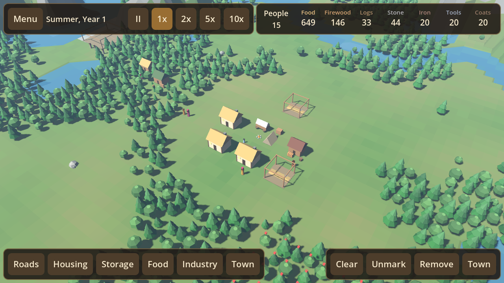
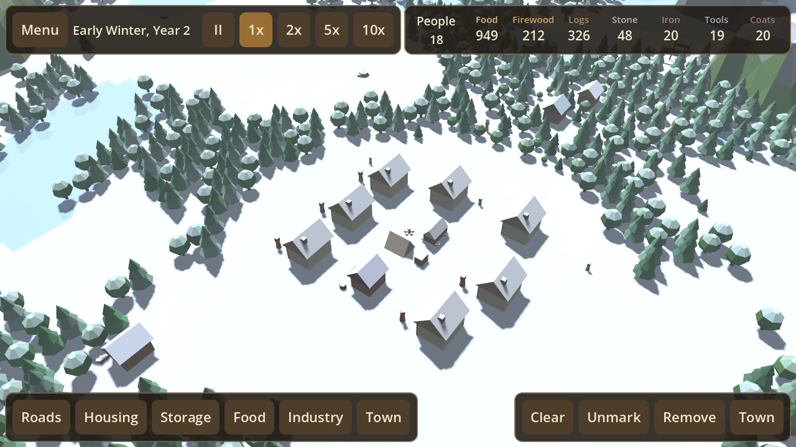
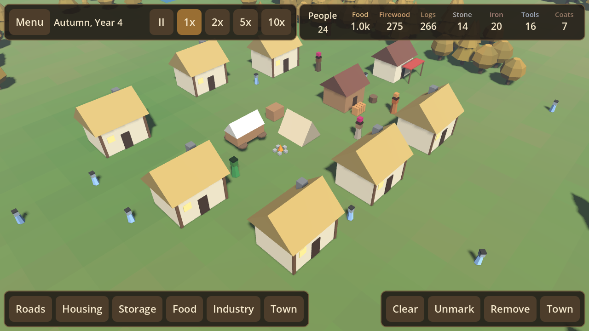
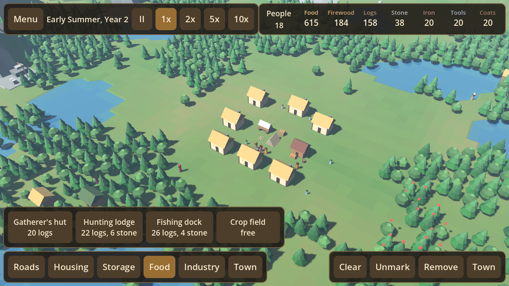

# Hearthstead

A Banished-style town builder for Android, made with Godot 4.7. Lead a band of
exiles through the seasons: there is no money, only what your people gather,
grow, cut and make. Keep them fed and warm, and the town grows.

<p>
 
 
</p>

## Playing

- **Move around:** drag with one finger, pinch to zoom, twist two fingers to turn.
- **Build:** pick a category at the bottom left, then a building. Tap the ground to
  move it and tap it again to build. Builders fetch the materials and put it up.
- **Work:** workplaces take labourers automatically. Tap a building to change how
  many work there. The rest are labourers who haul goods and clear marked land.
- **Survive:** people eat, need firewood in winter, wear out tools and coats, fall
  ill without herbs, and age. Families in houses have children, who start work at six.

Everything the town makes: food (berries, mushrooms, venison, fish, wheat, beans),
logs, firewood, stone, iron, tools, hides, coats and herbs. Nineteen buildings,
from the gatherer's hut to the chapel and the trading post. Fires, illness,
nomads and visiting merchants.

## How it is built

- `src/sim/` is the whole game as plain data and rules with no nodes, so it runs
  headless: `world.gd` (state, commands, monthly rules), `ai.gd` (what each person
  does), `map_gen.gd`, `defs.gd` (every number in one place), `save_game.gd`, and
  `autoplay.gd` (a simple player used for soak tests).
- `src/view/` draws it: procedural low-poly meshes (`meshes.gd`, no model files),
  `world_view.gd` with MultiMeshes for trees, people and crops, `camera_rig.gd` for
  touch, and `game.gd` which runs the clock and the tools.
- `src/ui/hud.gd` is the whole interface, built in code.

## Developing

```
tools/check.sh          # import, unit tests, 6-year soak of 3 towns, touch-input test
tools/screenshots.sh    # renders demo towns to build/shots
YEARS=10 SEEDS=1,2,3,4 tools/godot.sh --headless --path . --script res://tests/soak.gd
tools/godot.sh --headless --path . --script res://tests/probe.gd   # yield per worker
```

`tools/godot.sh` downloads Godot 4.7.2 on first use. Exporting the APK needs the
Android export templates and the Android SDK; see `.github/workflows/release.yml`.

Releases: push a `v*` tag. The workflow needs the secrets `HS_GAME_KEYSTORE_BASE64`,
`HS_GAME_KEYSTORE_PASSWORD` and `HS_GAME_KEY_ALIAS`.
